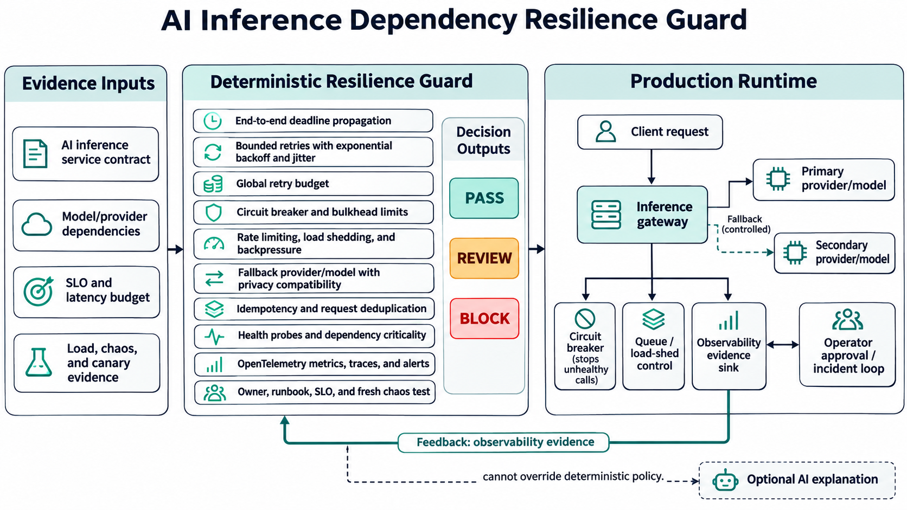

# AI Inference Dependency Resilience Guard

A deterministic policy gate that prevents fragile AI inference services from reaching production with unbounded retries, missing circuit breakers, unsafe fallbacks, or unverifiable reliability evidence.



## Why this matters now

AI applications often depend on several failure-prone services in one request: model providers, vector stores, rerankers, content filters, and identity or billing APIs. A slow dependency can consume the caller's entire deadline; synchronized retries can amplify overload; a fallback can silently violate residency or privacy constraints. Google SRE guidance treats overload and retry amplification as common causes of cascading failure, while current SRE and AI-infrastructure roles repeatedly ask for distributed-systems reliability, observability, capacity management, incident response, and production inference experience.

This project turns those expectations into an auditable pre-deployment contract. It is intentionally deterministic: an optional AI reviewer may explain findings, but cannot change the gate decision.

## What the guard validates

The CLI evaluates 18 controls and returns `PASS`, `REVIEW`, or `BLOCK`:

- End-to-end request budgets, propagated deadlines, and dependency timeouts
- Bounded exponential retries with jitter and retry budgets
- Circuit breakers, bulkheads, rate limits, backpressure, and load shedding
- Distinct provider/model fallbacks for critical dependencies
- Idempotency and request deduplication
- Dependency criticality, health probes, and capacity headroom
- OpenTelemetry metrics and traces for latency, errors, retries, breakers, and shedding
- Ownership, runbooks, dashboards, and alert routes
- Fresh chaos evidence for timeouts, rate limits, and provider outages
- Load-test evidence against latency and availability SLOs
- Fallback data classification and residency compatibility
- Canary rollout with automatic rollback

## Quick start

```bash
python -m venv .venv
source .venv/bin/activate
pip install -e .
inference-resilience-guard samples/compliant-contract.yaml --as-of 2026-11-11
```

Expected output:

```text
PASS | score=100.0% | 18/18 checks passed
```

Run the negative example with JSON output:

```bash
inference-resilience-guard samples/unsafe-contract.yaml --as-of 2026-11-11 --output json
```

## Architecture and operational flow

1. A service owner supplies a version-controlled resilience contract.
2. The guard loads the contract and organization policy.
3. Eighteen stable rules produce evidence-rich findings.
4. `BLOCK` stops a release, `REVIEW` requires an owner decision, and `PASS` permits the next deployment stage.
5. The runtime uses bounded concurrency, queues, circuit breakers, load shedding, and privacy-compatible fallbacks.
6. OpenTelemetry signals, load tests, and chaos experiments refresh the evidence for the next release.

The guard never calls a cloud provider or changes infrastructure. It is suitable for pull-request and audit workflows.

## Tests and validation

```bash
pip install -e . pytest
pytest -q
python -m compileall -q src tests
```

The unit suite covers a fully compliant contract, a deliberately unsafe contract, each critical control regression, and the non-blocking operational-review path. GitHub Actions repeats installation, tests, compilation, and both CLI evaluations on every push and pull request.

## Measurable outcomes

Teams can measure value with:

- 100% of critical dependencies covered by deadlines, breakers, bulkheads, and privacy-compatible fallbacks
- Retry traffic held below 10% of original traffic
- At least 25% tested capacity headroom
- Chaos evidence no older than 30 days
- Canary exposure capped at 10% with automatic rollback
- Reduced dependency-related mean time to detect and recover
- No SLO regression during tested provider timeout, rate-limit, and outage scenarios

These thresholds are policy defaults, not universal truths; organizations should tune them using production evidence and error-budget policy.

## Safe deployment guidance

Start in report-only mode against representative services. Review false positives with service owners, version the policy, then enforce only high-confidence blocking controls. Keep real provider credentials out of contracts and CI. Execute load and chaos tests in an isolated non-production environment with explicit limits. Promote changes through canaries, monitor both the primary and fallback paths, and retain a human approval gate for infrastructure-impacting actions. See [deployment guidance](docs/deployment.md).

## Security, privacy, and failure modes

- Contracts store configuration and evidence references, never prompts, model responses, credentials, or customer data.
- Fallbacks must preserve data classification and allowed regions.
- A policy or parser failure should fail closed in CI and never mutate runtime infrastructure.
- A stale passing contract is not proof of current resilience; chaos and load evidence expire.
- Circuit breakers can cause abrupt degradation if thresholds are too aggressive; observe and tune them.
- Fallback capacity can itself become a shared bottleneck; isolate and load-test it.
- An AI explanation layer is advisory only to prevent probabilistic output from bypassing controls.

## Interview positioning

Use this project to discuss a real production problem—dependency-driven cascading failure in AI inference—and why bounded retries alone are insufficient. Explain the design decision to separate deterministic enforcement from optional AI explanation, the trade-off between fail-fast behavior and availability, and the need to validate both primary and fallback paths. Evidence includes 18 executable controls, mutation-style regression tests, expiring chaos/load evidence, CI enforcement, and explicit privacy and rollout gates. It demonstrates SRE, platform engineering, observability, policy-as-code, and AI-infrastructure judgment.

## Repository map

```text
src/                         Deterministic engine and CLI
policy/                      Organization-level thresholds
samples/                     Passing and unsafe contracts
tests/                       Unit and regression tests
docs/                        Architecture, research, deployment
social/                      Medium, LinkedIn, and email drafts
.github/workflows/ci.yml     Reproducible validation
```

## Demand validation

The topic was checked against current official reliability and observability guidance and multiple live AI-infrastructure/SRE job descriptions. See [research notes](docs/research.md) for the evidence and limitations.

## License

MIT
