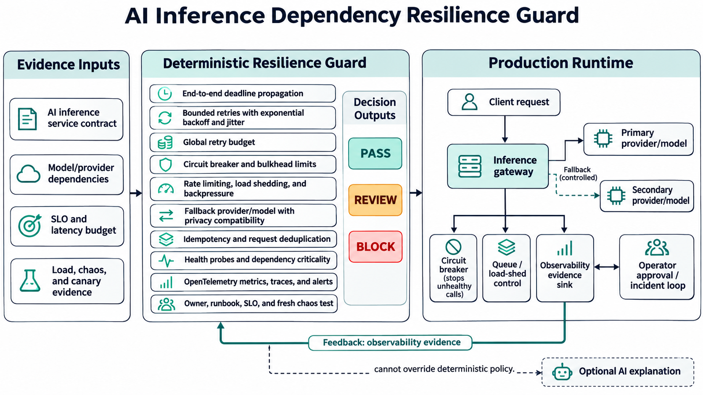

# Preventing Cascading Failures in AI Inference Dependencies

An AI request rarely depends on one component. A production path may call a model provider, vector store, reranker, safety filter, identity service, and billing API. When one slows down, the failure can spread: queues grow, timeouts consume the caller's deadline, synchronized retries multiply load, and a fallback becomes the next bottleneck.

That is why reliability engineering for AI infrastructure is in demand now. Current SRE and AI-platform openings repeatedly call for distributed-systems reliability, Kubernetes and cloud operations, observability, capacity management, and incident response. Google SRE guidance likewise identifies retry amplification and overload as major causes of cascading failures.

## The production problem

Teams often document retries, circuit breakers, and fallback providers separately. The release pipeline cannot answer whether the complete request path is safe. Even when a fallback exists, it may violate residency requirements, lack capacity, or use the same underlying provider as the primary route.

I built the **AI Inference Dependency Resilience Guard** to turn that fragmented knowledge into a deterministic release contract.

## Architecture

A version-controlled YAML contract describes the service SLO, request budget, dependencies, failure controls, observability, ownership, and test evidence. The Python guard evaluates 18 rules and produces `PASS`, `REVIEW`, or `BLOCK`. A BLOCK stops the release; REVIEW flags missing operational evidence; PASS permits the next deployment stage.

The runtime boundary includes the primary and fallback providers, bounded concurrency and queues, circuit breakers, load shedding, and OpenTelemetry signals. Operators refresh load and chaos evidence for future releases. An optional AI assistant may explain findings, but it cannot change the decision. Keeping enforcement deterministic makes the result reproducible and auditable.

## Implementation choices

The controls cover deadline propagation, per-dependency timeouts, exponential retries with jitter, retry budgets, circuit breakers, bulkheads, rate limits, backpressure, load shedding, distinct fallbacks, idempotency, health probes, capacity headroom, and canary rollback.

The observability contract requires latency, error, retry, breaker, and shed metrics plus traces and dependency attributes. Critical fallbacks must preserve the service's data classification and allowed regions. Fresh chaos evidence must cover provider timeout, throttling, and total outage; load evidence must satisfy the declared SLO and latency budget.

## Tests and validation

The test suite validates a compliant contract, a deliberately unsafe contract, individual regressions across the blocking controls, and a REVIEW-only case for missing runbook evidence. GitHub Actions installs the package, runs unit tests, compiles the source, evaluates both samples, and preserves deterministic failure behavior.

Useful measures include critical-dependency control coverage, retry amplification below 10%, at least 25% capacity headroom, chaos evidence no older than 30 days, canary exposure at or below 10%, and reduced dependency-related recovery time. These defaults must be tuned with real traffic and an error-budget policy.

## Deployment, security, and reliability

The safe adoption path begins in report-only mode. Teams should baseline production behavior, review false positives, and enforce high-confidence controls gradually. Load and chaos tests belong in an isolated non-production environment with spend, duration, concurrency, and blast-radius limits. Changes to breakers and fallbacks should use a small canary with automatic rollback.

Contracts must not contain credentials, prompts, model responses, or customer data. A fallback must satisfy the same classification and residency constraints as the primary path. Stale test evidence is not proof of current resilience, and an overly aggressive breaker can create unnecessary degradation, so thresholds need operational feedback.

## Trade-offs and lessons

Fail-fast controls protect capacity but may reduce apparent availability during short-lived faults. Retries can recover transient failures but become harmful without budgets and jitter. Fallbacks improve continuity but add cost, operational complexity, and privacy risk. The right answer is not maximal redundancy; it is evidence-backed behavior within a defined SLO.

The main lesson is that AI infrastructure needs the same disciplined distributed-systems controls as any critical platform, with extra attention to provider rate limits, inference cost, and fallback data handling.

## Interview positioning

This project demonstrates how I translate a production reliability problem into policy-as-code, tests, CI, observability requirements, and safe rollout guidance. I can discuss why the enforcement path is deterministic, how retry budgets and bulkheads prevent amplification, how privacy constrains fallbacks, what evidence should expire, and which trade-offs I would validate with real traffic. That connects directly to Cloud Engineering, DevOps, SRE, Platform Engineering, and AI-infrastructure roles.

Repository: https://github.com/ohjeffkuston/ai-inference-dependency-resilience-guard
